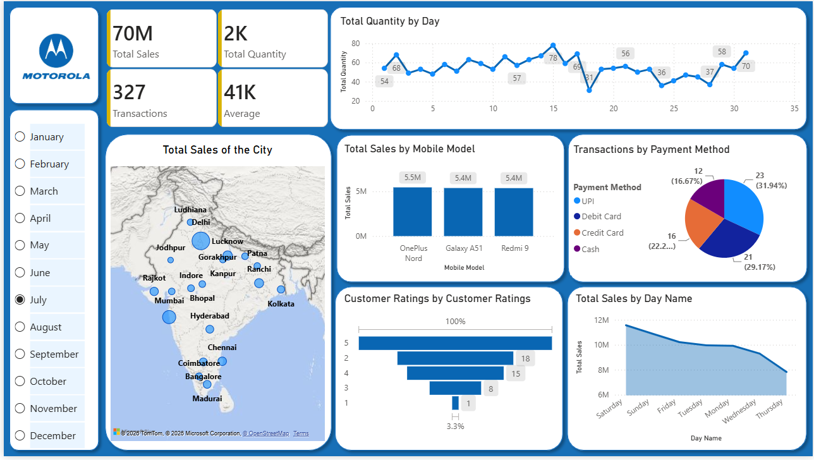
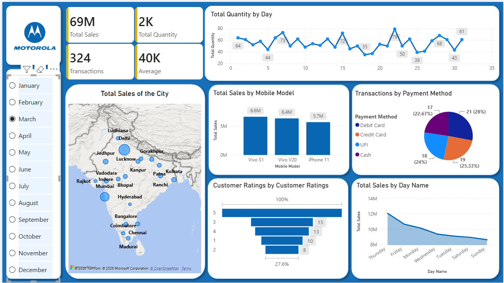
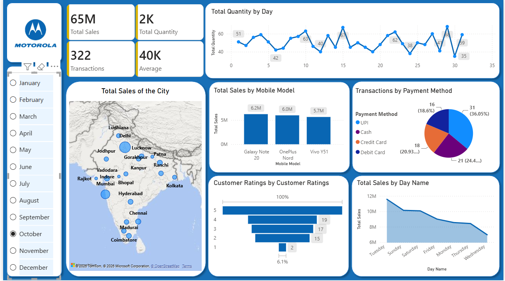

# Motorola Sales Analysis Dashboard — Power BI

## 📊 Project Overview

This project is an interactive **Power BI sales analysis dashboard** created to explore sales performance, transaction activity, product performance, customer ratings, payment methods, geographic distribution, and daily sales trends for **Motorola mobile devices**.

The dashboard uses a month selector to provide a month-wise view of the data. The screenshots below show the dashboard for different selected months.

> **Note:** The Power BI `.pbix` file is not included in this repository because the project was created in a Power BI environment that cannot be publicly shared. Screenshots are provided to demonstrate the completed dashboard and its analytical views.

---

## 🎯 Objectives

The dashboard was designed to:

- Monitor overall sales performance
- Track total quantity and number of transactions
- Analyze sales across different mobile models
- Understand transaction preferences by payment method
- Examine customer rating distribution
- Compare sales across days of the week
- Visualize geographic sales distribution across Indian cities
- Enable month-wise analysis through an interactive slicer

---

## 🛠️ Tools & Technologies

- **Microsoft Power BI**
- **Power Query** — data cleaning and transformation
- **DAX** — calculated measures and KPIs
- **Data Visualization**
- **Business Intelligence & Exploratory Data Analysis**

---

## 📌 Dashboard KPIs

The dashboard includes four key KPI cards:

| KPI | Description |
|---|---|
| **Total Sales** | Total sales value for the selected month |
| **Total Quantity** | Total number of mobile units sold |
| **Transactions** | Number of transactions recorded |
| **Average** | Average sales value represented in the dashboard |

These KPIs update when a different month is selected.

---

## 📈 Dashboard Components

### 1. Total Quantity by Day

A line chart showing how the quantity sold changes across individual days of the selected month.

This helps identify:

- High-volume sales days
- Low-volume sales days
- Daily fluctuations in demand

### 2. Total Sales by City

A geographic visualization showing sales distribution across cities in India.

The bubble size represents the relative sales contribution of different cities.

### 3. Total Sales by Mobile Model

A column chart comparing total sales generated by different Motorola/mobile models.

This can be used to identify higher-performing products.

### 4. Transactions by Payment Method

A pie chart showing the distribution of transactions across:

- UPI
- Debit Card
- Credit Card
- Cash

This provides an overview of customer payment preferences.

### 5. Customer Ratings

A visual breakdown of transactions/customers by rating from **1 to 5**.

This helps understand the overall customer satisfaction pattern.

### 6. Total Sales by Day Name

An area/line chart comparing sales across different days of the week.

This can help identify the strongest and weakest days for sales.

### 7. Month Selector

The left-side slicer allows the dashboard to be filtered by month:

- January
- February
- March
- April
- May
- June
- July
- August
- September
- October
- November
- December

---

# 🖼️ Dashboard Screenshots

## January View



---

## March View



---

## October View



---

## 🔍 Key Analytical Insights

The dashboard enables analysis of several business questions, such as:

- Which mobile models generate the highest sales?
- Which cities contribute the most to overall sales?
- Which payment method is used most frequently?
- Which days of the week generate higher sales?
- How does daily quantity fluctuate throughout a month?
- What is the distribution of customer ratings?
- How does sales performance change from one month to another?

Because the dashboard is interactive, selecting a different month changes the KPIs and visualizations to provide a month-specific view.

---

## 💡 Business Use Case

A dashboard like this can support business teams in:

- **Sales monitoring**
- **Product performance analysis**
- **Regional sales analysis**
- **Customer satisfaction analysis**
- **Payment behavior analysis**
- **Demand and sales trend analysis**

The insights can help businesses identify high-performing products and locations, understand customer behavior, and make more informed sales and marketing decisions.

---

## 📂 Repository Structure

```text
Motorola-PowerBI-Dashboard/
│
├── README.md
│
└── screenshots/
    ├── january-dashboard.png
    ├── march-dashboard.png
    └── october-dashboard.png
```

---

## 🚀 Future Improvements

Possible improvements to the dashboard could include:

- Year-over-year sales comparison
- Profit and margin analysis
- Product category analysis
- Customer segmentation
- More detailed regional drill-downs
- Sales forecasting
- Additional DAX-based KPIs
- Interactive drill-through pages

---

## 👩‍💻 Author

**Humaira Ali**

B.Tech — Electronics & Communication Engineering  
VIT Bhopal University

---

## ⭐ Project Note

This project was created as a **Power BI portfolio project** to practice data cleaning, DAX, interactive dashboard development, data visualization, and business-oriented analysis.
